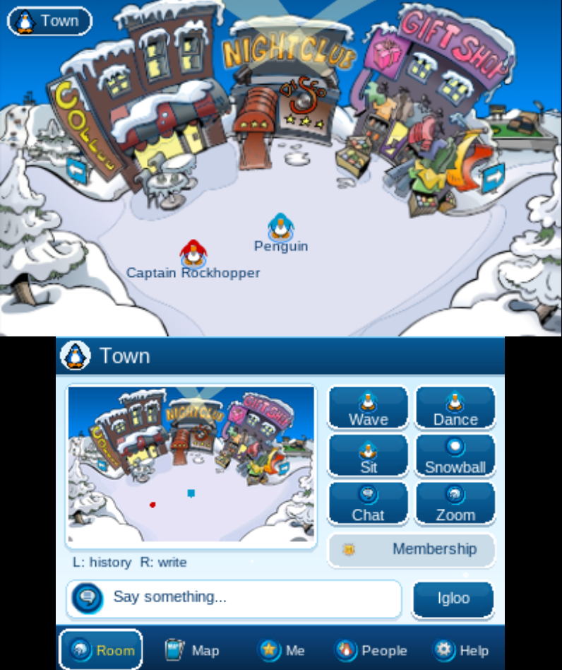
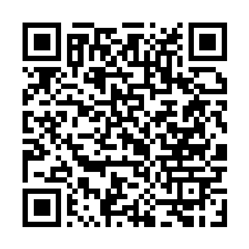

# GoPenguin for Nintendo 3DS

Explore the island, chat, dress your penguin and play games in the same world as [gopenguin.lol](https://gopenguin.lol), together with players on PC and mobile.

**[Download for Nintendo 3DS](https://github.com/Tweebbo/gopenguin-3ds/releases/latest)** · [Release notes](docs/RELEASE.md)

GoPenguin 1.3.6, captured in an emulator configured as an Old 3DS.

## Install

You need a Nintendo 3DS or 2DS with custom firmware (Luma3DS).

- Install `gopenguin.cia` with FBI.
- Or copy `gopenguin.3dsx` to `sdmc:/3ds/` and launch it from the Homebrew Launcher.

### Install with a QR code

Open FBI → Remote Install → Scan QR Code. This code always downloads the latest CIA.

GoPenguin offers updates inside the game. You can also check from Help → Account → Updates. Keep the `3ds/gopenguin` folder on your SD card when updating.

## On the island

- Visit rooms, chat, make friends and send postcards.
- Dress your penguin, furnish your igloo and care for your puffles.
- Play Card-Jitsu, Sled Racing, Find Four, Mancala and the classic minigames.
- Take on an Agent mission.
- Use the same penguin on 3DS, PC and mobile.

## Controls

| Control | Action |
| --- | --- |
| Circle Pad / D-Pad | Walk |
| Touch screen | Walk on the map, open panels and select people |
| A | Talk to the character nearby or chat |
| B | Sit, close or cancel |
| X / Y | Wave / dance |
| R / L | Write / read chat history |
| C-Stick | Turn while seated |
| START | Quit |

See the [player guide](docs/GUIDE.md) for chat, graphics options, games and moving your penguin between devices.

## Project

[Build and test](docs/DEVELOPING.md) · [Player changelog](https://gopenguin.lol/changelog/)

This is an unofficial fan project. Original game artwork belongs to its respective owners. Third-party source notices are retained in `vendor` and the source files.
