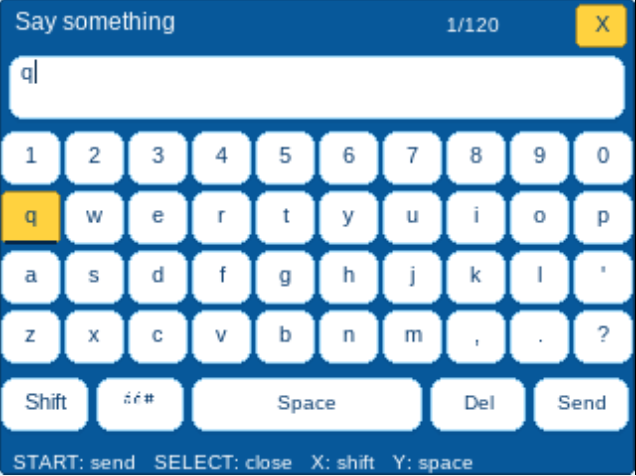
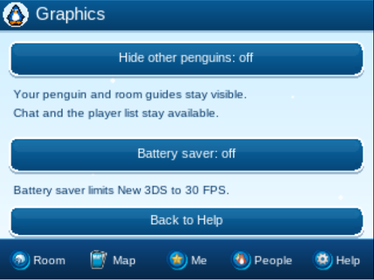

# Player guide

## Chat

- Press R or touch Chat to write. Press L to read the last 100 messages of this session.
- In history, L/R turn pages, Up/Down scroll a line, A writes and B returns.
- On the keyboard, START sends, SELECT closes, B deletes, X or L changes case, Y adds a space and R switches between letters and symbols.

Letters appear when you touch a key. Send and Close act when you release on the same button.

## Your penguin

- Touch Me for clothes and inventory. Help → Account groups transfers, name and updates.
- Your saved penguin connects automatically. The first connection creates one for you.
- Change your name in Help → Account → Change name. Your connection and penguin ID stay the same.
- Talk to Captain Rockhopper in Town to receive his free background. You do not need to send a suggestion.
- While seated, turn with the C-Stick, or hold B and use the Circle Pad, D-Pad or map.

## Games

Card-Jitsu and Card-Jitsu Fire are available from the Sensei in the Dojo and Fire Dojo, or from Help → Games. Get a starter deck from the game menu when needed.

Left/Right inspects cards and A plays the selected card. Hold a card to inspect its full illustration, release to play, or drag outside to cancel. Matches and belt progress are saved by the server.

## Continue on another device

**From 3DS to PC or phone:** in Help → Account → Transfer penguin, choose To PC. Scan the QR with your phone, or open gopenguin.lol and enter the short code in Account → Enter device code.

**From PC or phone to 3DS:** choose Account → Use on another device on the website, then enter the code in Help → Account → Transfer penguin → From PC.

Only the eight characters are needed. Codes work once and expire after ten minutes, so keep them private. Your penguin, coins and belongings stay the same.

## Graphics

Help → Graphics → Hide other penguins reduces the work needed to draw a crowded room. It is off by default. Your penguin and room guides stay visible. Other players' chat, emotes, history and the People list stay available while their avatars are hidden. The setting is saved on the SD card.

Help → Graphics → Battery saver keeps your preference on the SD card. On New 3DS it uses the normal CPU clock with L2 cache and 30 FPS. Normal mode allows the faster CPU and up to 60 FPS during activity, then saves automatically after two quiet seconds. Input restores the active profile immediately. Original 3DS uses the normal clock and 30 FPS in both modes. A CPU clock request failure is shown in Graphics; the frame cap still applies.

## Updates

GoPenguin checks for releases in the background and offers updates inside the game. You can also open Help → Account → Updates. Downloads resume after a connection drop and are verified before installation. The CIA keeps its Title ID and your saved penguin.

If the game stops at "Could not load demo assets", install the latest CIA or 3DSX again. Your penguin is kept.
